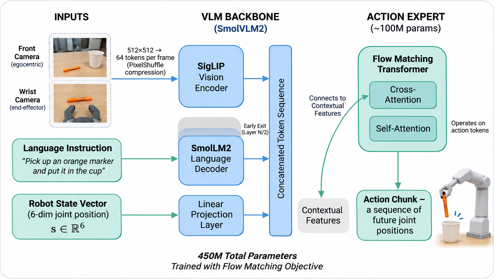
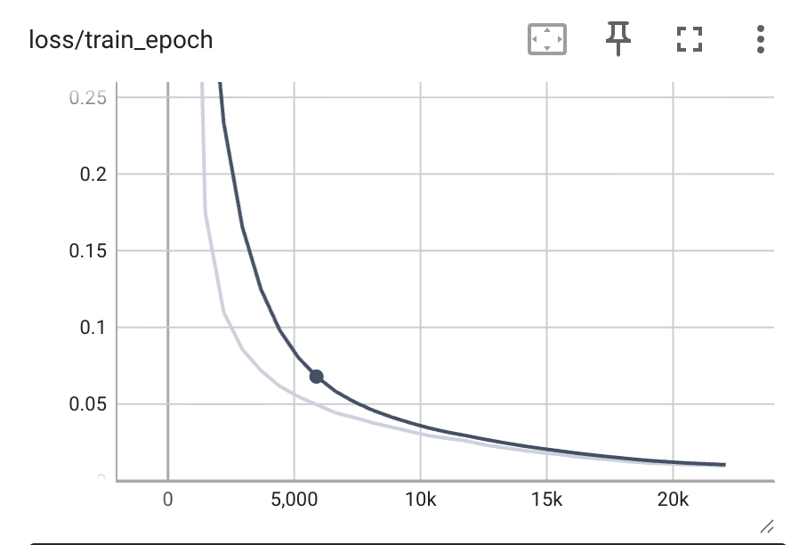
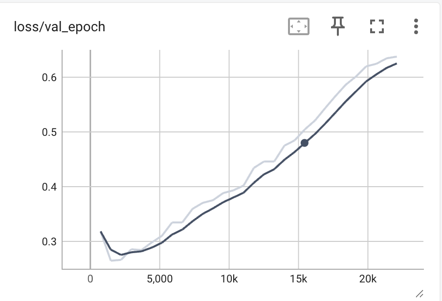
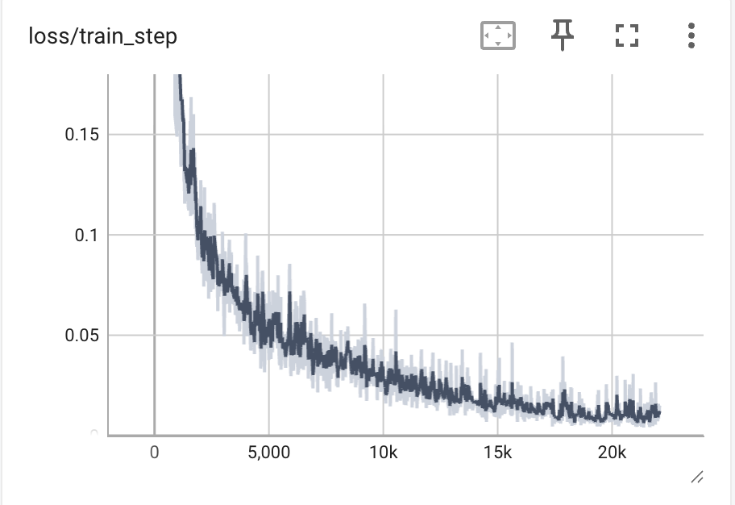
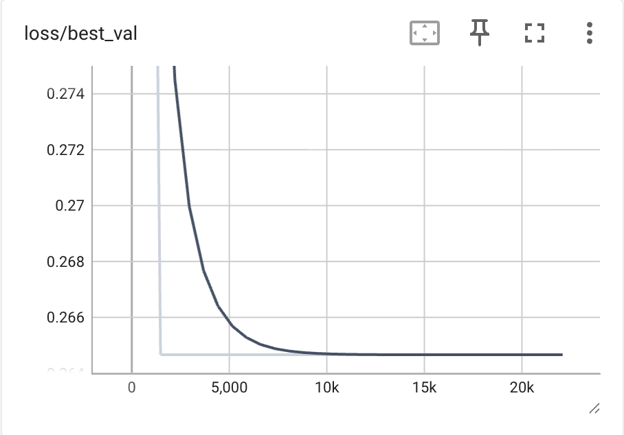
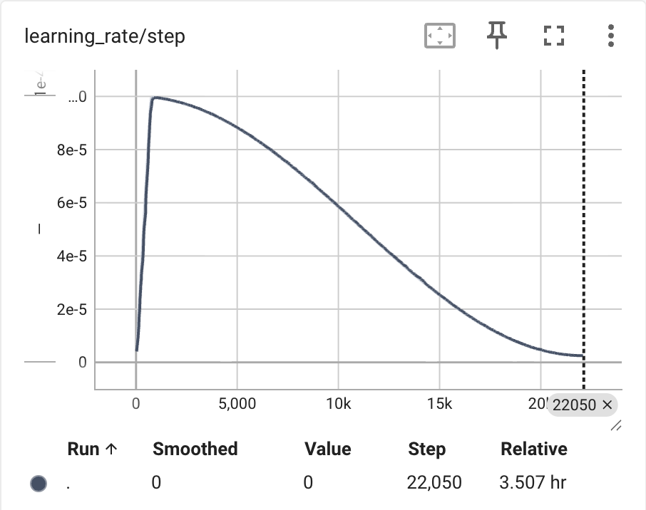
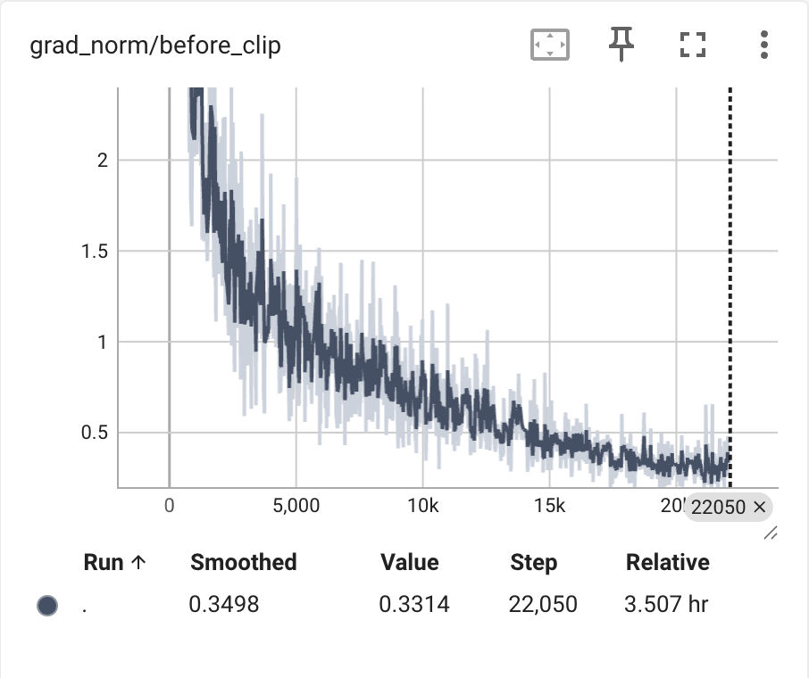

# SmolVLA-Lite-Lab

**An educational SmolVLA implementation with a complete training and evaluation workflow for SO-ARM101.**

This project connects dual-camera observations, a language instruction, and robot joint state to chunked action prediction. It includes demonstration recording (teleoperation, recording dashboard), episodic data loading, flow-matching training, checkpoint recovery, offline action evaluation, and a real-robot rollout interface.

[Training guide](docs/training_guide/README.md) · [Experiment configuration](docs/evaluation/pick_place_final/training_config.json) · [Training history](docs/evaluation/pick_place_final/history.json) · [Offline results](docs/evaluation/pick_place_final/policy_best.eval.json)

## Model architecture

<table>
  <tr>
    <td align="center">
      <strong>Model architecture</strong> 
      
    </td>
  </tr>
</table>

Front and wrist images and the instruction provide visual-language context through a frozen, pretrained **SmolVLM2-500M-Video-Instruct** backbone. A trainable action expert uses this context, projected robot state, noisy actions, and a flow timestep to predict action velocities. At inference, Euler integration transforms Gaussian noise into an action chunk, which is denormalized into six robot joint targets.

The reported configuration uses one observation timestep, a **50-step action chunk**, and **10 Euler steps**. State and action vectors contain six physical dimensions and are padded internally to 32 dimensions. Padding is excluded from the training objective.

**Initialization:** the VLM starts from pretrained weights; the action expert and projection layers are initialized for this project. The reported run trains these action components while freezing the VLM. Direct loading of the official `lerobot/smolvla_base` policy is not implemented; `--finetune` and `--resume` accept this repository's local checkpoints.

## Training metrics

<table>
  <tr>
    <td align="center" width="50%">
      <strong>Training loss by epoch</strong> 
      
    </td>
    <td align="center" width="50%">
      <strong>Validation loss by epoch</strong> 
      
    </td>
  </tr>
  <tr>
    <td align="center">
      <strong>Training loss by update</strong> 
      
    </td>
    <td align="center">
      <strong>Best validation loss</strong> 
      
    </td>
  </tr>
  <tr>
    <td align="center">
      <strong>Learning rate</strong> 
      
    </td>
    <td align="center">
      <strong>Gradient norm before clipping</strong> 
      
    </td>
  </tr>
</table>

*Figures: TensorBoard scalars from `pick_place_final`. The horizontal axis is optimizer updates, including for epoch-level loss points. When exporting screenshots, retain the raw traces and state the smoothing setting. `loss/best_val` is a running minimum; its flat region means no new best checkpoint was found.*

### Experiment setup

| Setting | Reported run |
| --- | --- |
| Robot | SO-ARM101, six joint targets including gripper |
| Task instruction | “Pick up an orange marker and put it in the cup” |
| Dataset | 54 demonstration episodes |
| Split | 43 training episodes / 11 validation episodes; split by episode |
| Training / validation observation timesteps | 23,516 / 5,621 |
| Cameras | Front and wrist; recorded at 640 × 480, resized with padding to 512 × 512 |
| Normalization | Per-dimension state/action mean and standard deviation from training episodes only |
| Training budget | 30 epochs, 735 updates per epoch, 22,050 updates total |
| Batch size / data-loader workers | 32 / 4 |
| Optimizer | AdamW; betas `(0.9, 0.95)`, weight decay `1e-10` |
| Learning rate | Peak `1e-4`, warmup followed by cosine decay, floor `2.5e-6` |
| Gradient clipping | Maximum norm 10 |
| Chunk / executed actions per prediction / Euler steps | 50 / 50 / 10 |
| Training device / seed | RTX 5090 (CUDA) / 0 |

This is a single-seed experiment. Validation episodes are used for checkpoint selection; they are not an independent test set. Exact recorded arguments, policy configuration, split membership, and normalization statistics are available in the [experiment configuration](docs/evaluation/pick_place_final/training_config.json).

### Offline action evaluation

The selected checkpoint is evaluated on all **5,621 validation observations**, using its saved split, instructions, normalization, and validation seed 0. Each observation predicts a 50-step chunk. End-of-episode padding is excluded, leaving **267,575 valid chunk timesteps**, including overlapping predictions of the same recorded trajectory timesteps.

| Metric | Best-checkpoint evaluation | Last-checkpoint evaluation |
| --- | ---: | --- |
| Flow-matching loss | **0.264907** | 0.637668 |
| Aggregate action MSE, original joint scales | 161.216711 | **111.169454** |
| Aggregate action MAE, original joint scales | 8.578988 | **6.366987** |
| Checkpoint epoch index | 2 completed epochs | 30 completed epochs |

### Key Finding: Lowest validation loss doesn't mean Overfitting

Validation flow-matching **loss reached its minimum after two epochs**
(1,470 optimizer updates), then increased while training loss continued
to decrease. This pattern is **consistent with overfitting** with respect
to the measured flow-matching objective, but does not by itself establish
deterioration in generated actions or closed-loop task performance.

##### Validation Loss != Hold-out Action Error

| Metric | Meaning |
| --- | --- |
| FLow-matching validation loss |  velocity-prediction error on noise-corrupted demonstration actions |
| Hold-out action error | discrepancy between demonstrated actions and action chunks generated |

## Real-robot evaluation

**Status: structured rollout evaluation and videos to be added.**

<table>
  <tr>
    <td align="center" width="50%">
      <strong>Nominal pick-and-place</strong> 
      <em>Robot rollout video to be added.</em>
      <!-- Replace with a clickable video thumbnail after uploading the video:
      
      -->
    </td>
    <td align="center" width="50%">
      <strong>Failure analysis / varied object placement</strong> 
      <em>Robot rollout video to be added.</em>
      <!--  -->
    </td>
  </tr>
</table>

## Implementation map

| Path | Purpose |
| --- | --- |
| `smolvla_scratch/models/` | VLM/expert integration, attention, flow matching, and policy action queue |
| `smolvla_scratch/configuration/` | Model, optimizer, and scheduler configuration |
| `smolvla_scratch/data_process/` | Observation preprocessing and action postprocessing |
| `smolvla_scratch/utils/vla_utils.py` | Episodic dataset and shared utilities |
| `smolvla_scratch/train_infer.py` | Training, offline evaluation, and rollout entry point |
| `smolvla_scratch/checkpointing.py` | Model/training checkpoints and recovery state |
| `smolvla_scratch/training_logging.py` | TensorBoard logging |
| `data_recording/` | Leader–follower teleoperation and recording |
| `low_control/` | Hardware configuration and robot environment |
| `docs/` | Usage documentation, evaluation records, and figure/video assets |

## Current scope

The reported evidence covers one task, one dataset split, and one training seed. Broader task generalization and independent test-set performance have not been measured. The robot runner executes action chunks synchronously and does not establish a sustained 30 Hz closed-loop rate. Guided RTC is not supported by this rollout entry point. No automatic task-success detector is implemented.

## References and acknowledgments

This project follows the SmolVLA design and adapts components from LeRobot for learning and experimentation.

- [SmolVLA: A Vision-Language-Action Model for Affordable and Efficient Robotics](https://arxiv.org/abs/2506.01844) — Shukor et al., 2025.
- [Hugging Face LeRobot](https://github.com/huggingface/lerobot) — reference implementation and robot interfaces.
- [SmolVLM2-500M-Video-Instruct](https://huggingface.co/HuggingFaceTB/SmolVLM2-500M-Video-Instruct) — pretrained visual-language backbone.
